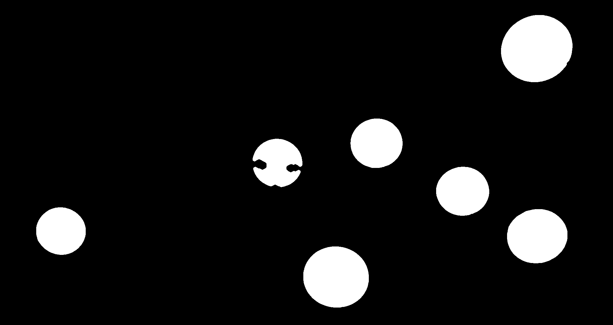
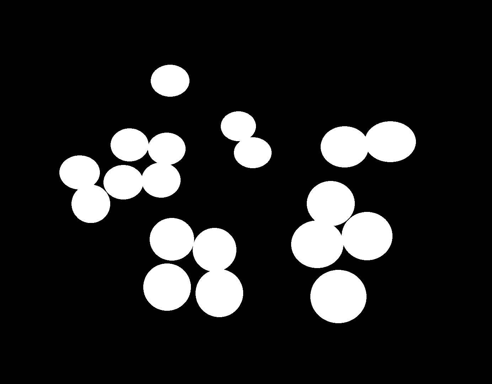
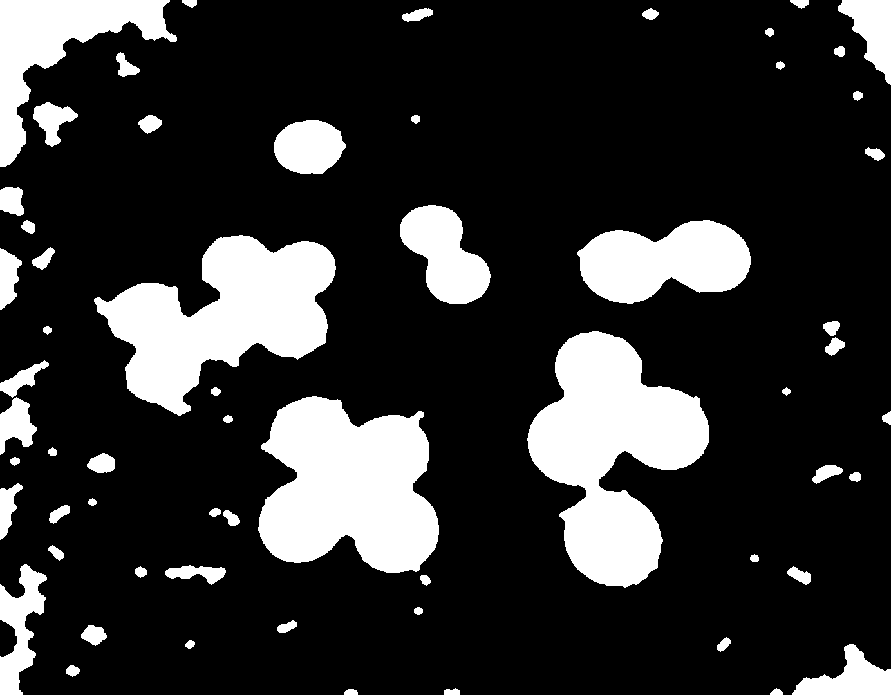

# Relatório parcial M2

**Projeto:** Identificação e Contagem de Moedas

**Integrantes:** Gabriel Maximiano dos Santos, Diego Augusto Carvalho, Seiki Takao Iizuka

**Data:** 27/10/2026

**Etapa:** M2

## Objetivo da M2

Demonstrar e avaliar a segmentação das moedas nas fotos próprias. A classificação e soma do valor total ficam para a M3.

## Resposta ao feedback da M1

| Recomendação | Situação |
|---|---|
| Implementar e medir a segmentação antes da CNN | Parcialmente atendida: há segmentador, comparação de IoU em quatro imagens e baseline de contagem nas dez fotos. |
| Criar máscaras/contagens verdadeiras para as dez fotos | Contagens e valores totais foram contados manualmente para as dez imagens; máscaras de segmentação existem para quatro. |
| Separar métricas de detecção, classificação e valor total | Há contagem detectada e erro por imagem, além de IoU nas quatro máscaras. Classificação e soma automáticas não foram implementadas. |
| Tratar moedas encostadas ou retirá-las do escopo | Moedas encostadas ainda não são separadas. Para este protótipo, o resultado é uma máscara conjunta; a separação fica para a M3. |
| Conferir classes COCO e evitar vazamento no dataset | O dataset Kaggle/COCO não foi usado nesta M2; a conferência será feita no treinamento da M3. |
| Fazer uma baseline nas dez imagens, com quantidade real e detectada | Baseline inicial incluída abaixo: compara contagem manual com círculos brutos detectados pelo Hough. |

## Dados e protótipo

O conjunto de imagens de teste tem dez fotos autorais em `images/input/`, com fundos lisos e texturizados e moedas isoladas, próximas ou agrupadas. As quantidades e valores totais contados manualmente estão em [images/input/README.md](../images/input/README.md). Há quatro máscaras de segmentação em `images/segmentacaoManual/`.

O script `src/main.py` converte a foto para tons de cinza, aplica mediana 7x7, limiarização de Otsu e operações morfológicas com kernel elíptico 7x7; depois salva a máscara. O script `src/identifica.py` procura círculos com `HoughCircles` e os desenha na foto; usa `dp=1.2`, `minDist=30`, `param1=100`, `param2=35` e raios de 15 a 100 pixels.

Os comandos e resultados dos testes por imagem estão em [docs/teste_parametros.md](teste_parametros.md).

Instale as dependências e rode um exemplo a partir da raiz do repositório:

```bash
python -m pip install -r requirements.txt
python src/main.py --entrada images/input/diversas_fundoTexturizado.jpg --saida images/results/exemplo.png --abertura 2 --fechamento 2
python src/identifica.py --entrada images/input/diversas_fundoTexturizado.jpg --saida images/results/diversas_fundoTexturizado_identificacao.png
```

## Experimentos

Aumentar o fechamento de 2 para 4 melhora a máscara sem prejudicar fundos texturizados?

Foram mantidos as mesmas quatro imagens, referências, abertura (2), limiar e kernel. Só o número de iterações do fechamento mudou.

| Imagem | IoU: fechamento 2 | IoU: fechamento 4 |
|---|---:|---:|
| `diversas_espalhadas_papel` | 0,8217 | 0,8540 |
| `diversas_espalhadas_papel2` | 0,8794 | 0,9066 |
| `diversas_fundoTexturizado` | 0,7705 | 0,6775 |
| `diversas_porCima_papeljpg` | 0,7971 | 0,8273 |
| **Média macro** | **0,8172** | **0,8164** |

Para cada foto, comparamos a máscara gerada com a máscara manual que fizemos. O IoU é a proporção de pixels de moeda que coincidem: pixels brancos iguais nas duas máscaras divididos pelos pixels brancos que aparecem em pelo menos uma delas. A **média macro** é a média simples dos quatro IoUs. Cada foto tem o mesmo peso.

Assim chegamos aos valores da tabela:

- Fechamento 2: (0,8217 + 0,8794 + 0,7705 + 0,7971) / 4 = **0,8172**.
- Fechamento 4: (0,8540 + 0,9066 + 0,6775 + 0,8273) / 4 = **0,8164**.

O fechamento 4 melhorou três fotos, mas piorou a foto texturizada; a média macro praticamente não mudou e ficou abaixo de 0,90. O caso de melhora foi `diversas_espalhadas_papel2`; o caso de falha foi `diversas_fundoTexturizado`. Este IoU é calculado sobre a máscara inteira, não por moeda.

**Máscara de referência e resultado com fechamento 4:**

| Caso de melhora | Caso de falha |
|---|---|
|   |   |

Para repetir os testes, você pode usar o mesmo comando nas duas configurações, substituindo o nome da foto:

```bash
python src/main.py --entrada images/input/<foto>.jpg --saida images/results/<foto>_fc2.png --abertura 2 --fechamento 2
python src/main.py --entrada images/input/<foto>.jpg --saida images/results/<foto>_fc4.png --abertura 2 --fechamento 4
```

## Baseline de contagem

Para cada foto, a quantidade detectada é o número de círculos retornados por `src/identifica.py`, sem remover duplicatas. O erro absoluto é a diferença entre essa quantidade e a contagem manual. Os valores em reais abaixo são referências contadas manualmente; o programa ainda não estima valores.

| Imagem | Moedas reais | Círculos detectados | Erro absoluto | Total manual |
|---|---:|---:|---:|---:|
| `diversas_espalhadas_papel.jpg` | 6 | 17 | 11 | R$ 1,96 |
| `diversas_espalhadas_papel2.jpg` | 7 | 12 | 5 | R$ 2,25 |
| `diversas_fundoTexturizado.jpg` | 19 | 21 | 2 | R$ 4,32 |
| `diversas_fundoTexturizadoFlash.jpg` | 19 | 25 | 6 | R$ 4,32 |
| `diversas_porCima_papeljpg.jpg` | 6 | 41 | 35 | R$ 2,05 |
| `poucas_bemPerto_papel.jpg` | 5 | 19 | 14 | R$ 1,95 |
| `poucas_fundoTexturizado.jpg` | 4 | 6 | 2 | R$ 1,45 |
| `poucas_perto_fundoTexturizado.jpg` | 5 | 7 | 2 | R$ 1,46 |
| `poucas_perto_papel.jpg` | 5 | 6 | 1 | R$ 1,95 |
| `real_papel.jpg` | 1 | 4 | 3 | R$ 1,00 |

O erro absoluto médio é **8,1 moedas por imagem**, por conta de o detector conta círculos repetidos e falsos positivos.

## Limitações e próximos passos da M3

- Criar referências de segmentação para as outras seis fotos.
- Reduzir círculos duplicados e falsos positivos e repetir a avaliação da contagem.
- Desenvolver o algoritimo de classificação e soma valor total.

## Contribuições, referências e IA

A